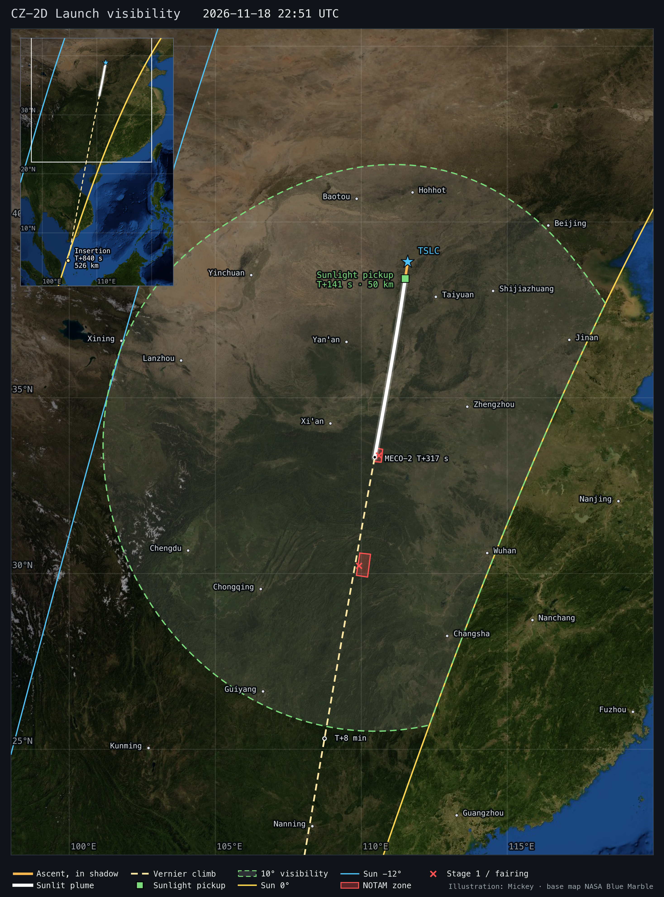

# CZ-2D from Taiyuan, 2026-11-18 — ascent, insertion orbit and the dawn twilight plume

Two NOTAMs (`notam_tslc_sso`) close a stage-1 zone (A5897/26, 22:43–23:05 UTC) and a fairing zone (A5898/26,
22:44–23:10 UTC) south of Taiyuan LC-9. The model takes the launch as the follow-up of 2026-218 (PIESAT-2 13–16)
and flies the same orbit: **526 km circular, i 97.49°**. Model T0 is **22:51:00 UTC (06:51 BJT, 19 Nov)**.

[3D page](https://exoplanet5.github.io/CZ-2D/?profile=sso&mission=cz2d-tslc-1118) · [repository overview](../../README.md)



## Why PIESAT-2, and why 22:51

- The stage-1 zone is corner-for-corner the zone of Y99 (2024-12-16, PIESAT-2 09–12) and of Y104 (2026-09-19,
  PIESAT-2 13–16 = 2026-218). The fairing zone differs from theirs by 1′ in one corner. Both flights went to
  518 × 533 km, i 97.49° (first TLEs).
- Y105 (2026-03-25, Superview Neo 2-05/06, 500 × 513 km) used different zones: stage 1 52 km nearer, fairing
  52 km farther. So the zones point to the PIESAT-2 profile, not the Superview one.
- T0 = stage-1 NOTAM start + 8 min on Y99 (18:42 → 18:50) and on Y105 (22:43 → 22:51, the same window as now).
  Y104 was + 7 min (10:43 → 10:50). 22:50 is the alternative; one minute moves the RAAN by 0.25°.
- GCAT lists 2026-218 at Jiuquan. Space-Track (site TSC) and the NOTAM zones put it at Taiyuan, which is what
  this model uses.

## Ascent

| event | T+ (s) | UTC | lat, lon | alt (km) | v (km/s) | downrange (km) |
|---|---|---|---|---|---|---|
| lift-off | 0 | 22:51:00 | 38.863 N 111.590 E | 1.4 | – | 0 |
| MECO-1 / hot staging | 156.7 | 22:53:36 | 38.139 N 111.461 E | 64.1 | 2.32 | 81 |
| fairing jettison | 208.2 | 22:54:28 | 37.027 N 111.252 E | 110.6 | 2.91 | 206 |
| main-engine cutoff (MECO-2) | 316.7 | 22:56:16 | 33.309 N 110.460 E | 217.9 | 5.72 | 626 |
| vernier cutoff / insertion | 840.4 | 23:05:00 | 5.326 N 104.727 E | 526 | 7.60 | 3793 |

- Launch azimuth 187.66°. The plane at MECO-1 has i 88.4°, so stage 2 flies a 9° dogleg to reach 97.49°.
- Stage 1 lands on the zone centre (fit target) at T+561 s, 618 km downrange.
- The fairing lands at 30.226 N 109.919 E, 972 km downrange: 4 km long and 15 km west of the zone axis. The zone
  is 72 × 35 km, so that is inside it but near the western edge.
- Payload 1200 kg (four ~270 kg satellites plus dispenser). Capacity on this corridor is 1872 kg, and the
  propellant margin is 672 kg.

## Insertion orbit

- 526 × 526 km, i 97.490°, **RAAN 328.28°** at 23:05:00 UTC; LTAN 18:17 (descending node 06:17), a dawn-dusk plane.
- Predicted elset (`CZ-2D_TSLC_20261118_SSO526.tle`):

```
CZ-2D TSLC 1118 PAYLOAD
1 99118U 26998A   26322.96250486  .00000000  00000-0  00000-0 0  9997
2 99118  97.4950 328.2821 0012818 290.4398 248.0178 15.15392639    09
```

- The RAAN includes +0.09°: Y99 and Y104 came out 0.09° and 0.10° east of the fuel-optimal model plane.
- The real flights were inserted at 518 × 533 km; the model inserts on a circle at the mean altitude.

## Dawn twilight plume

- At T0 the Sun is 6.1° below the horizon at the pad (azimuth 110°); sunrise there is about 29 min later.
- The vehicle reaches direct sunlight **before staging**: geometric at T+115 s (32 km), and clear of the lower
  atmosphere (Sun ray ≥ 20 km) at **T+141 s, 50 km**, 53 km downrange. The whole stage-2 main burn
  (T+157–317 s, 64 → 218 km) is sunlit over ground still in twilight (Sun −5.4° to −4.0° below the track).
- After MECO-2 only the 47 kN vernier burns (6 % of the main-phase thrust), so its plume is far fainter. By
  insertion the ground below is in daylight (Sun +2.6°).
- The map shows where the sunlit main-engine arc (from clear sunlight to MECO-2) rises ≥ 10°, cut at the Sun 0°
  line for 22:54:56 UTC. The 3D page starts its zone at the geometric pickup and cuts it at the Sun 0° line of the
  pickup epoch, so its outline differs slightly near the pad and along the terminator.

| city | Sun (°) | max elevation (°) | azimuth (°) | range (km) | at T+ (s) |
|---|---|---|---|---|---|
| Xi'an | −5.8 | 51 | 110 | 262 | 307 |
| Yan'an | −6.1 | 42 | 115 | 212 | 246 |
| Taiyuan | −4.3 | 39 | 254 | 142 | 184 |
| Zhengzhou | −2.3 | 33 | 263 | 334 | 292 |
| Wuhan | −0.2 | 22 | 311 | 529 | 316 |
| Shijiazhuang | −2.9 | 19 | 239 | 383 | 234 |
| Chongqing | −6.1 | 18 | 41 | 610 | 316 |
| Chengdu | −8.5 | 15 | 62 | 718 | 316 |
| Lanzhou | −10.3 | 14 | 114 | 723 | 316 |
| Yinchuan | −9.2 | 14 | 138 | 649 | 294 |
| Hohhot | −5.9 | 13 | 186 | 463 | 215 |
| Beijing | −2.3 | 10 | 226 | 723 | 265 |

- The sky is darkest in the west (Lanzhou, Yinchuan, Chengdu: Sun −8° to −10°), but the plume is low there and
  seen toward the dawn glow. Xi'an and Yan'an have the plume high in a civil-twilight sky (Sun −6°).
- East of about 113° E the Sun is within 3° of the horizon and the sky is bright; the zone ends at the terminator.
- All cities and the full table are in `CZ-2D_TSLC_20261118_twilight.json`.

## Files

Scripts are in the repository root; outputs land in this folder.

- `build_traj.py --mission tslc1118` → `CZ-2D_TSLC_20261118_{solution.json,traj.csv,orbit.csv,traj.kml,SSO526.tle}` (40 s).
- `twilight_visibility.py --mission tslc1118` → `CZ-2D_TSLC_20261118_{twilight.json,visibility.png}`.
- `web_export.py --mission tslc1118` → `docs/data/cz2d-tslc-1118.json` and `CZ-2D_TSLC_20261118_page_ref.json`.
- `validate_precedents.py --site TSLC` → Taiyuan flights in `validation.json` (20 s).

## Assumptions and uncertainty

- **Mission:** the PIESAT-2 identification and the 526 km / 97.49° target are inferred from the zones, not
  announced. The payload mass is an estimate; ±200 kg changes the timeline by about a second.
- **T0:** known only from the NOTAM pattern, ±1 min. The Sun rises 0.2° per minute, so the twilight geometry
  barely changes; the RAAN moves 0.25° per minute.
- **Validation on Taiyuan flights** (standard vehicle, T0 to the minute):

| flight | orbit | ΔRAAN vs first TLE | fairing vs its zone (along / cross) |
|---|---|---|---|
| Y99 2024-12-16 PIESAT-2 09–12 | 526 km, 97.49° | −0.09° | +10 / +18 km |
| Y104 2026-09-19 PIESAT-2 13–16 | 526 km, 97.49° | −0.10° | +15 / +18 km |
| Y105 2026-03-25 Superview Neo 2-05/06 | 507 km, 97.44° | +0.12° | +123 / +7 km |

- **Fairing cross-track:** the model starts the yaw toward the SSO plane at stage-2 ignition (fuel-optimal),
  which puts the fairing 15–18 km west of the zone axis. Holding the MECO-1 plane until fairing jettison
  (`fly(hold_plane=True)`) puts it 32 km east and moves the RAAN by +0.45°. The real steering lies between; the
  ground track could be up to ~15 km east of the model in the first minutes of stage 2.
- **Y105 is not reproduced:** the model fairing overshoots its zone by 123 km. That flight used a shorter
  stage-1 drop and a different profile; it does not bear on the PIESAT-2 zones.
- **Terrain and pad heights** (pad 1.45 km, zones 0.8 and 1.2 km) are estimates; 0.5 km moves an impact < 0.5 km.
- **Twilight:** sunlit means the Sun ray clears a 6371 km sphere (geometric) or passes ≥ 20 km above it (clear).
  Plume brightness against the sky is not modelled; the zone is geometric visibility only.
- Vehicle and profile assumptions are those of `README.md` (stage-2 dry mass 4.5 t, long vernier climb).

## Sources

- NOTAM archive `~/launch/notam/notam_data.json` (Y99, Y104, Y105 zones).
- First TLEs and launch sites: Space-Track.org (`precedents/st_2024-241.json`, `st_2026-062.json`, `st_2026-218.json`).
- Launch times, pad coordinates and satellite masses: data from GCAT (J. McDowell, planet4589.org/space/gcat), CC-BY 4.0.
- Base map: NASA Blue Marble.
