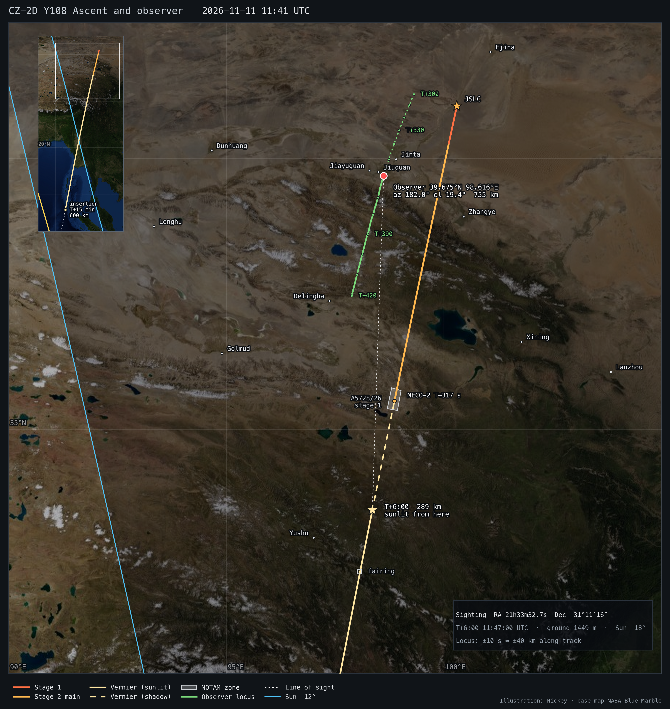

# CZ-2D Y108 — ascent, 600 km SSO insertion, and the T0+6 min observer

[3D page](https://exoplanet5.github.io/CZ-2D/?profile=sso&mission=cz2d-y108) · [repository overview](../../README.md)

Long March 2D Y108 lifted off from Jiuquan LC-43/94 on 2026-11-11 at 19:41 BJT (11:41 UTC) with the CAS
"Origins" Pathfinder (探源计划探路者卫星). NOTAM A5728/26 (ZLHW, 11:32–12:05 UTC) is the stage-1 drop zone,
614 km from the pad on a 192.2° bearing. The official release says the rocket flew its first "3.35 m composite
fairing + lightened stage 2 + no fins + composite support bay" configuration *to meet the satellite's lift
requirement*: the payload is at the limit of the vehicle.

## Ascent (600 km SSO, i 97.788°)

| event | T+ (s) | UTC | lat, lon | alt (km) | v (km/s) |
|---|---|---|---|---|---|
| MECO-1 / hot staging | 156.7 | 11:43:36 | 40.252 N 100.108 E | 63.6 | 2.30 |
| fairing jettison | 207.7 | 11:44:27 | 39.173 N 99.821 E | 110.8 | 2.87 |
| main-engine cutoff | 317.2 | 11:46:17 | 35.524 N 98.865 E | 228.3 | 5.62 |
| **T0+6 min** | 360.0 | 11:47:00 | **33.518 N 98.358 E** | **288.6** | 5.65 |
| vernier cutoff / insertion | 874.4 | 11:55:34 | 6.597 N 92.388 E | 600.0 | 7.56 |

Stage 1 lands on the zone centre at T+522 s; the fairing falls 975 km downrange (32.38 N 98.06 E).
Payload capacity on this corridor: **1811 kg** for the lightened vehicle (1598 kg standard). The model
payload is set to 1811 kg. Predicted elset: `CZ-2D_Y108_SSO600.tle` (RAAN 141.03° for T0 11:41:00).

## Observer

Seen at RA 21h33m32.7s, Dec −31°11′16″ (taken as ICRS / plate-solved) at T0+6 min:

- **39.675 N, 98.616 E, ground 1449 m.** The observer looked almost due south (az 182.0°, el 19.4°) at a range
  of 755 km, with the Sun at −18°. That is 12 km ESE of central Jiuquan (Suzhou District), in the Hexi Corridor.
- The time uncertainty moves the site along a NNE–SSW line (`observer_locus.csv`): ±10 s ≈ 35–46 km, ±30 s ≈
  100–125 km. T+5:30 is 40.51 N 98.97 E; T+6:30 is 38.60 N 98.25 E (Qilian Shan, 4.4 km).
- The rocket climbs out of the Earth's shadow exactly at T+6:00 (the Sun-ray tangent height crosses 0 km at
  T+360 s and 20 km at T+372 s). A plume 755 km away at night is seen only once sunlit, so the sighting is no
  earlier than ~T+6:00. The towns on the inhabited part of the line are Jiuquan (12 km off it), Jiayuguan (30 km)
  and Jinta (13 km, but before sunlight).

## Assumptions and uncertainty

- **Orbit:** the 600 km SSO is the user's working assumption. The corridor (az 191.3°) is 3.5–4° east of the
  standard CZ-2D SSO corridor (194.6–195.6° on Y97/Y100/Y101/Y42). On this model it points to i ≈ 94–95°;
  flying SSO from it needs about 3.4° of extra dogleg, which costs about 200 kg. With i 94.5° the T+6 min
  observer moves 32 km east.
- **Vehicle:** stage loads, thrusts and Isp are published (CGWIC/SAST). The stage-2 dry mass of 4.5 t is
  calibrated to 1.9 t to 500 km SSO. The Y108 mass savings (−250 kg fairing, −150 kg stage 2 and support bay,
  −300 kg fins) are estimates.
- **Profile:** the main-engine cutoff is propellant-optimal, followed by a long vernier climb. This is the only
  profile family that reproduces the published 500 → 700 km capacity drop; no CZ-2D event timeline is published.
  A 300 s vernier tail would move the observer 144 km north, but it falls 1.6 t short.
- **Validation (`validation.json`):**
  - Capacity: 1899 / 1252 kg at 500 / 700 km SSO, against 1900 / 1300 kg published.
  - Plane: precedent RAAN is +0.09 to +0.32° from the first TLEs.
  - Fairing: the Y41 fairing lands 15 km from its NOTAM zone.
- **Observer error budget at T+6:00** (beyond the time locus): payload ±300 kg ≈ 11 km; plane bias 5.5 km;
  RA/Dec read as equinox-of-date instead of J2000 ≈ 6.5 km; terrain from ETOPO1 1′ (geoid ignored, < 0.1 km).

## Sources

- Launch release: 新浪/航天八院, 2026-11-11 (长征二号丁遥108, 探源计划探路者卫星, 19:41).
- CZ-2D data: CGWIC LM-2D page; SAST LM-2D page; Xinhua 2025-09-29 (1.9 t to 500 km SSO); CASC (1.3 t to 700 km SSO).
- Precedent orbits and TLEs: Space-Track.org; launch times and masses: GCAT (J. McDowell, planet4589.org, CC-BY 4.0).
- NOTAM archive `~/launch/notam/notam_data.json`; terrain NOAA ETOPO1 via ERDDAP.
